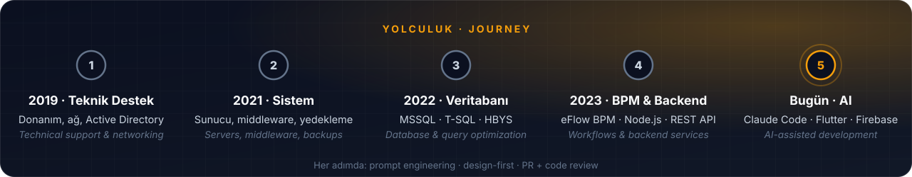
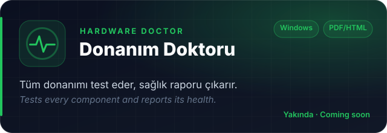
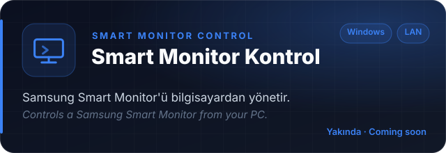
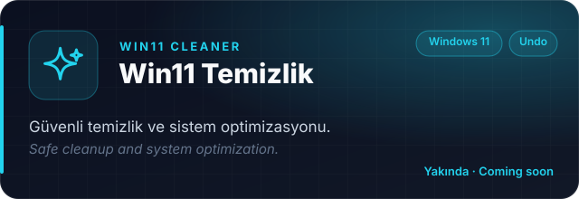

  

  
  
  

<table>
<tr>
<td width="50%" valign="top">

### Hakkımda

Backend Developer'ım. Bilgi teknolojilerinde 5 yılı aşkın deneyimim var: teknik destek ve sistem yönetimiyle başladım, veritabanı ve backend geliştirmeyle devam ettim.

Node.js ile RESTful API servisleri geliştiriyor, Microsoft SQL Server üzerinde data modeling ve query optimization yapıyor, BPM (Business Process Management) platformlarında iş süreçlerini dijitalleştiriyorum.

AI-assisted development çalışma şeklimin merkezinde. Claude Code ile multi-agent bir yapıyı yönetiyor; requirements analysis, code review ve release kararlarını üstleniyorum. Prompt engineering alanında kendimi geliştirmeye devam ediyorum.

</td>
<td width="50%" valign="top">

### About Me

I'm a Backend Developer with 5+ years in IT. I started in technical support and system administration, then moved into database and backend development.

I build RESTful API services with Node.js, do data modeling and query optimization on Microsoft SQL Server, and digitalize business processes on BPM (Business Process Management) platforms.

AI-assisted development is central to how I work. I lead a multi-agent setup with Claude Code and own requirements analysis, code review and release decisions. I keep improving my prompt engineering skills.

</td>
</tr>
</table>

## Çalışmalar ve Etkileri · Work & Impact

<table>
<tr>
<td width="50%" valign="top">

**BPM Platformu · Workflow Engine** 
Node.js · Express.js · MSSQL · *ekip projesi*

Web tabanlı bir BPM platformunun backend ekibinde yer aldım. Ekip olarak geliştirdiğimiz yapılar:

- **Workflow engine:** Process template, process instance ve task yönetimi. Satış, stok, muhasebe ve İK gibi 20'den fazla iş süreci bu engine üzerinde çalışıyor.
- **Process designer:** Görsel süreç tasarımını MSSQL veri modeline dönüştüren katman; data dictionary ve data source yönetimi.
- **Scheduler:** Cron tabanlı scheduled ve recurring task tetikleme.
- **ERP entegrasyonu:** Logo Tiger ERP'ye REST API üzerinden sipariş aktarımı ve XML/JSON dönüşümü. Manuel veri girişini ortadan kaldırıyor.
- **DMS (Document Management System):** Kategori bazlı doküman yönetimi, file upload ve PDF işleme.
- **Handheld terminal API'leri:** Depo operasyonları için order picking ve stok servisleri.
- **Notification service:** SMTP ile şablonlu e-posta bildirimleri; Firebase Authentication ile kullanıcı ve grup senkronizasyonu.

Bu projedeki rolüm: RESTful API geliştirme, süreç analizi ve tasarımı, MSSQL entegrasyonları ve SQL tabanlı raporlama.

**Enterprise Portal** 
Flutter · Firebase · AI-assisted development

- **Multi-agent development:** Web ve mobilde çalışan, 20'den fazla modülden oluşan kurumsal portalı Claude Code ile geliştiriyorum; planlama, tasarım, kodlama ve test agent'larını yönetiyorum.
- **RBAC (Role-Based Access Control):** Rol bazlı yetkilendirme ve Firestore Security Rules tasarımı.
- **Audit log:** Immutable denetim kaydı ve KVKK/GDPR uyumu.
- **Server-side validation:** Cloud Functions ile sunucu tarafı doğrulama; FCM ile deep-linked push notification.

**Database** 
MSSQL · T-SQL

- Relational database design ve data modeling.
- Stored procedure, view ve UDF geliştirme; CTE ve window function içeren ileri seviye T-SQL.
- Query optimization ve SQL tabanlı raporlama.

**Önceki Deneyim**

- **Software Support (HIS):** Hastane bilgi sisteminde root cause analysis; canlı MSSQL veritabanında troubleshooting, query optimization ve data wrangling.
- **System Administration:** Windows Server, Active Directory, firewall ve backup yönetimi.
- **Technical Support:** Bilgisayar, sunucu ve network donanımlarının kurulumu ve bakımı.

</td>
<td width="50%" valign="top">

**BPM Platform · Workflow Engine** 
Node.js · Express.js · MSSQL · *team project*

I was part of the backend team of a web-based BPM platform. What we built as a team:

- **Workflow engine:** Process templates, process instances and task management. More than 20 business processes run on it, including sales, stock, accounting and HR.
- **Process designer:** A layer that turns visual process designs into the MSSQL data model; data dictionary and data source management.
- **Scheduler:** Cron-based triggering of scheduled and recurring tasks.
- **ERP integration:** Order transfer to Logo Tiger ERP over REST API with XML/JSON conversion. It removes manual data entry.
- **DMS (Document Management System):** Category-based document management, file upload and PDF processing.
- **Handheld terminal APIs:** Order picking and stock services for warehouse operations.
- **Notification service:** Templated email notifications over SMTP; user and group sync with Firebase Authentication.

My role in this project: RESTful API development, process analysis and design, MSSQL integrations and SQL-based reporting.

**Enterprise Portal** 
Flutter · Firebase · AI-assisted development

- **Multi-agent development:** I develop an enterprise portal with 20+ modules for web and mobile with Claude Code, leading planning, design, coding and testing agents.
- **RBAC (Role-Based Access Control):** Role-based authorization and Firestore Security Rules design.
- **Audit log:** Immutable audit logging and KVKK/GDPR compliance.
- **Server-side validation:** Validation with Cloud Functions; deep-linked push notifications with FCM.

**Database** 
MSSQL · T-SQL

- Relational database design and data modeling.
- Stored procedures, views and UDFs; advanced T-SQL with CTEs and window functions.
- Query optimization and SQL-based reporting.

**Earlier Experience**

- **Software Support (HIS):** Root cause analysis in a hospital information system; troubleshooting, query optimization and data wrangling on a live MSSQL database.
- **System Administration:** Windows Server, Active Directory, firewall and backup management.
- **Technical Support:** Installation and maintenance of computers, servers and network hardware.

</td>
</tr>
</table>

  

## Projeler · Projects

Testleri tamamlanınca paylaşılacak · Will be shared once testing is complete

  
  
  
  

### Diğer Çalışmalar · Other Work

| Proje · Project | Türkçe | English |
|---|---|---|
| **Cihaz Merkezi** | Klavye ve fare için RGB ve pil yönetimi | RGB and battery manager for keyboard & mouse |
| **PC Kumanda** | Bilgisayarları uzaktan açma ve kapatma | Turn PCs on and off remotely |
| **Trading Bot** | Kripto ve BIST için Telegram alarm botu | Telegram alert bot for crypto and BIST |
| **Tidewater Pier** | Phaser 3 ile cozy/idle oyun | Cozy/idle game built with Phaser 3 |

## Nasıl Çalışıyorum · How I Work

<table>
<tr>
<td width="50%" valign="top">

1. **Requirements analysis:** İhtiyacı analiz eder, workflow'u tasarlarım.
2. **Prompt engineering:** Kapsamı, kısıtları ve acceptance criteria'yı net yazarım.
3. **Multi-agent orchestration:** Planlama, kodlama ve test agent'larını yönetirim.
4. **Code & security review:** Kodu, security rules'u ve testleri incelerim.
5. **Release:** Yayın kararını veririm.

</td>
<td width="50%" valign="top">

1. **Requirements analysis:** I analyze the need and design the workflow.
2. **Prompt engineering:** I write clear scope, constraints and acceptance criteria.
3. **Multi-agent orchestration:** I lead planning, coding and testing agents.
4. **Code & security review:** I review the code, security rules and tests.
5. **Release:** I make the release decision.

</td>
</tr>
</table>

## Teknolojiler · Tech Stack

| Alan · Area | |
|---|---|
| **Diller · Languages** |     |
| **Backend** |     |
| **Veritabanı · Database** |     |
| **Mobil · Web** |   |
| **Veri · Data** |    |
| **Süreç · Process** |    |
| **AI & Araçlar · Tools** |     |

## Eğitim · Education

| Bölüm · Program | Okul · School | Yıl · Years |
|---|---|---|
| Yönetim Bilişim Sistemleri (Lisans) · B.Sc. Management Information Systems | Anadolu Üniversitesi · Anadolu University | 2022 – 2026 |
| Bilgisayar Programcılığı (Ön Lisans) · Associate Degree, Computer Programming | Sakarya Uygulamalı Bilimler Üniversitesi · Sakarya University of Applied Sciences | 2019 – 2021 |

  

Her gün biraz daha iyi · A little better every day

