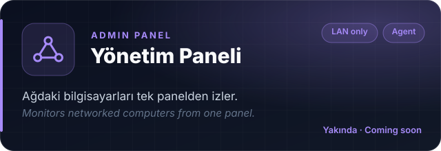

  

<table>
<tr>
<td width="50%" valign="top">

### Hakkımda

2019'dan beri bilgi teknolojilerinde çalışıyorum. Teknik destekle başladım, veritabanı ve BPM üzerinden backend geliştirmeye geçtim.

Bugün Node.js ve MSSQL ile iş süreçlerini dijitalleştiriyor, Claude Code ile yapay zekâ ajanlarını yöneterek uçtan uca ürün geliştiriyorum.

</td>
<td width="50%" valign="top">

### About Me

I've been working in IT since 2019. I started in technical support and moved into backend development through databases and BPM.

Today I digitalize business processes with Node.js and MSSQL, and build products end-to-end by directing AI agents with Claude Code.

</td>
</tr>
</table>

## Neler Yapıyorum · What I Work On

<table>
<tr>
<td width="50%" valign="top">

- **BPM & Workflow Engine** · *ekip projesi* 
  Node.js ve MSSQL üzerinde 20'den fazla iş sürecini yürüten platformun backend'i. RESTful API, süreç tasarımı ve Logo Tiger ERP entegrasyonu.
- **Enterprise Portal** 
  Flutter + Firebase ile 20'den fazla modüllü kurumsal portal. RBAC, immutable audit log ve KVKK uyumu.
- **Database** 
  MSSQL'de data modeling, T-SQL, stored procedure ve query optimization.
- **AI-Assisted Development** 
  Requirements analysis → prompt → multi-agent geliştirme → code review → release.

</td>
<td width="50%" valign="top">

- **BPM & Workflow Engine** · *team project* 
  Backend of a platform that runs 20+ business processes on Node.js and MSSQL. RESTful APIs, process design and Logo Tiger ERP integration.
- **Enterprise Portal** 
  A 20+ module enterprise portal built with Flutter + Firebase. RBAC, immutable audit logs and KVKK/GDPR compliance.
- **Database** 
  Data modeling, T-SQL, stored procedures and query optimization on MSSQL.
- **AI-Assisted Development** 
  Requirements analysis → prompt → multi-agent development → code review → release.

</td>
</tr>
</table>

## Projeler · Projects

Testleri tamamlanınca paylaşılacak · Will be shared once testing is complete

  
  
  
  

  

## Teknolojiler · Tech Stack

  
  
  
  
  
  
  
  
  
  

## İletişim · Contact

  

Yönetim Bilişim Sistemleri · Anadolu Üniversitesi · Ankara

